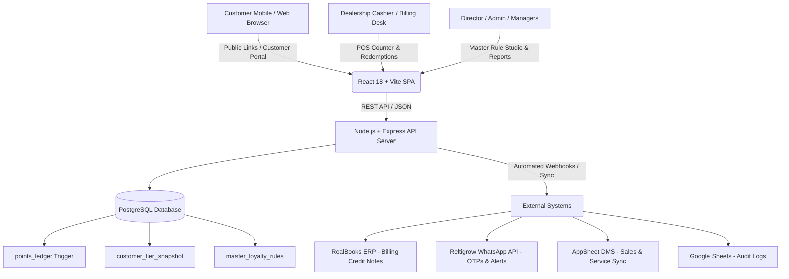
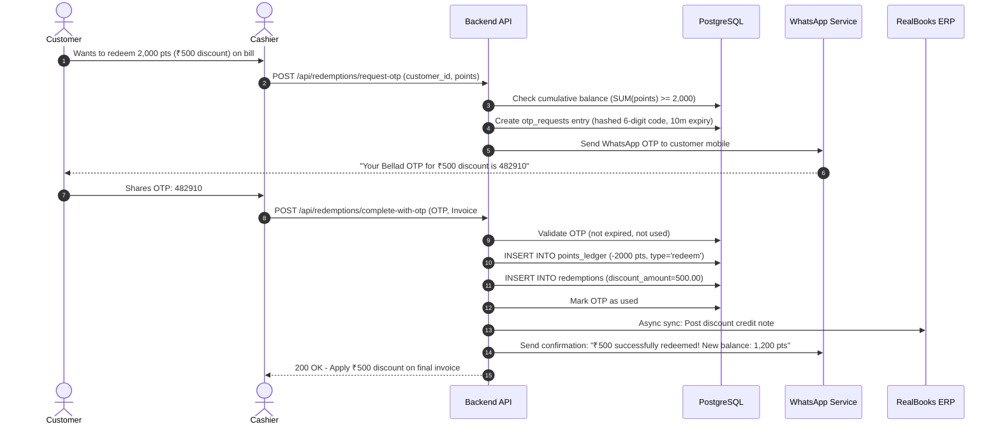

# Bellad & Co. Dealership Loyalty & Rewards Platform
## Complete Project Architecture, Page Inventory & Business Logic Guide

---

## 1. Executive Summary & Core Philosophy

The **Bellad & Co. Dealership Loyalty Platform** is an enterprise-grade automotive customer loyalty, retention, and rewards platform built for multi-branch automobile dealerships (Tata, Hero, MG, Mahindra, etc.).

### Key Engineering Principles:
1. **Append-Only Immutable Ledger (`points_ledger`)**:
   - Points are never updated in place (`UPDATE points_ledger SET points = ...` is blocked by a database trigger).
   - Every balance change is an immutable entry (positive for earn, negative for redeem/expire). Cumulative customer balance is always calculated as `SUM(points)`.
2. **Integer & Paise Arithmetic**:
   - Monetary amounts are recorded in integer **paise** (`₹1.00 = 100 paise`) or exact integers to prevent IEEE-754 floating-point rounding errors.
3. **Anti-Fraud Security**:
   - Redemptions require dual authorization: Cashier invoice submission + Customer WhatsApp/SMS OTP verification.
   - Idempotency keys prevent duplicate earning entries on network retries.
4. **Director-Controlled Dynamic Rules Engine ("The Brain")**:
   - Executive Directors can customize earning and discount schemes across models, variants, branches, and dates without deploying new code.

---

## 2. System Architecture & Tech Stack

### Technology Breakdown:
- **Frontend**: React 18, Vite, Tailwind CSS, Lucide-react icons, Vanilla Canvas Confetti.
- **Backend**: Node.js, Express, `pg` (node-postgres pool), JWT authentication, `bcryptjs` password/PIN hashing.
- **Database**: PostgreSQL (with Trigram search extensions `pg_trgm`, `citext`, schema migrations runner).
- **Integrations**: RealBooks ERP, WhatsApp Business API (Reltigrow), AppSheet Vehicle DMS, Google Sheets.

---

## 3. Complete Page & Screen Directory

Here is every single screen in the frontend, how it is accessed, which APIs it calls, and what it does:

| Page / Screen Component | Route / URL Path | Target Audience | Key Purpose & Functionality | Connected Backend APIs |
| :--- | :--- | :--- | :--- | :--- |
| **`LoginScreen.jsx`** | `/` (when not logged in) | Cashiers, Managers, Admins | Role-based authentication with username and password. | `POST /api/auth/login` `GET /api/auth/me` |
| **`CashierDashboard.jsx`** | `/` (Tab: `dashboard`, `search`, `redemptions`) | Billing Cashiers & Desk Staff | **POS Counter**: Real-time customer search (Phone, Name, VIN, Chassis). Displays balance, tier, vehicles. Calculates sale/service points and triggers OTP redemptions. | `GET /api/search` `GET /api/customers/:id` `POST /api/points/earn` `POST /api/redemptions/request-otp` `POST /api/redemptions/complete-with-otp` |
| **`CustomerPortalScreen.jsx`** | `/portal` `/customer-portal` | Vehicle Owners & Customers | Self-service customer app. Automatically switches between `EnrollmentScreen` and `PortalDashboardScreen`. | `POST /api/v1/auth/request-otp` `POST /api/v1/auth/verify-otp` |
| **`EnrollmentScreen.jsx`** | Sub-view of Customer Portal | New or Returning Customers | Customer login/registration with Phone number, Name, Aadhaar number, and optional Referral Code via OTP. | `POST /api/v1/auth/request-otp` `POST /api/v1/auth/verify-otp` |
| **`PortalDashboardScreen.jsx`** | Sub-view of Customer Portal | Logged-in Customers | Shows customer points balance, tier badge (Silver/Gold/Platinum), QR code pass, ledger statement, gift card wallet, friend referral manager, and profile. | `GET /api/v1/customer/profile` `GET /api/v1/customer/ledger` `GET /api/v1/customer/referrals` `GET /api/v1/gifts/my-cards` `POST /api/v1/gifts/send` |
| **`PublicBalancePassScreen.jsx`** | `/balance/:token` | Any Customer (No login required) | Digital loyalty pass linked via secure signed token. Shows real-time balance, barcode/QR code for cashier scanning, and recent activity. | `GET /api/public/balance/:token` |
| **`PublicReferralLeadScreen.jsx`** | `/refer/:code` | Friend / Referred Prospect | Public landing page where friends referred by existing customers submit their name, phone, and interested vehicle model. | `POST /api/public/referral-lead` |
| **`PublicGiftClaimScreen.jsx`** | `/gift/:token` `/claim-gift/:token` | Gift Card Recipients | Recipient portal to view a gifted voucher, reveal the 4-digit PIN, or claim value. | `GET /api/public/gift/:token` `POST /api/public/gift/claim` |
| **`CustomerRedemptionsScreen.jsx`** | Tab: `customer_redemptions` | Admins | Comprehensive audit report of all discount redemptions, vouchers utilized at billing desks, and RealBooks sync statuses. | `GET /api/admin/redemptions` |
| **`GiftCardsScreen.jsx`** | Tab: `gift_cards` | Cashiers & Admins | Dealership desk tool to issue new 16-character gift cards, search voucher balances, and verify PINs. | `POST /api/gift-cards/issue` `POST /api/gift-cards/check-balance` `POST /api/gift-cards/redeem` |
| **`ReferralsScreen.jsx`** | Tab: `referrals` | Sales Managers & Admins | Track customer advocacy leads through lifecycle (`lead_created` → `in_progress` → `purchased` → `pr_delivered` → `points_awarded`). Manage slabs. | `GET /api/referrals` `POST /api/referrals/lead` `PATCH /api/referrals/:id/status` `POST /api/referrals/slabs` |
| **`MasterRuleEditorScreen.jsx`** & **`StandaloneMasterEditorPortal.jsx`** | `/editor` Tab: `master_editor` | Executive Director & Admins | **The Dealership Brain**: Create dynamic earning rules and discounts per vehicle type (2W, 4W, EV), spend category, brand, model, branch, and date range. | `GET /api/master-editor/rules` `POST /api/master-editor/rules` `PUT /api/master-editor/rules/:id` `DELETE /api/master-editor/rules/:id` |
| **`LoyaltyAppBuilder.jsx`** | `/builder` `/app-builder` | Platform Super Admin | White-label studio to customize dealership branding, colors, modules (toggle sales, service, bodyshop, tiers), and tenant settings. | `GET /api/tenants/config` `PUT /api/tenants/config` |
| **`ReportsScreen.jsx`** | Tab: `reports` | Admins & Accountants | Real-time analytics, total points liability, outstanding balances, daily transaction logs, RealBooks sync failures, and CSV data exports. | `GET /api/reports/summary` `GET /api/reports/ledger` `GET /api/reports/realbooks-sync` |
| **`KycApprovalsScreen.jsx`** | Tab: `kyc_approvals` | General Managers | Queue to review and approve customer profile changes (Aadhaar cards, name corrections, nominee updates). | `GET /api/kyc/pending` `POST /api/kyc/:id/approve` `POST /api/kyc/:id/reject` |
| **`CorrectionsQueueScreen.jsx`** | Tab: `corrections_queue` | Managers & Auditors | Queue for manual point correction requests to reverse erroneous cashier entries safely. | `GET /api/corrections/queue` `POST /api/corrections/approve` |
| **`TenantManagementScreen.jsx`** | Tab: `tenants` | Super Admin | Manage multi-tenant organizations (Bellad & Company, Trident Automobiles, Advaith Motors). | `GET /api/tenants` `POST /api/tenants` |
| **`AdminDuplicateScreen.jsx`** | Tab: `admin` | System Admin | Detect duplicate customer profiles sharing phone numbers or names and merge them safely into a single canonical customer record. | `GET /api/admin/duplicates` `POST /api/admin/merge-customers` |

---

## 4. Deep Dive: Core Business Logic & Workflows

### 1. Points Earning Engine (`points.service.js` & `masterRuleEngine.service.js`)

#### A. Standard Rules vs Master Policy Rules
When a customer completes a transaction at the dealership:
1. **Master Rule Check**: The system checks `master_loyalty_rules` ("The Brain") for any active rule matching:
   - Tenant ID (e.g., `bellad_and_company`)
   - Spend Type (`sale`, `service`, `accessories`, `bodyshop`)
   - Vehicle Type (`2W`, `4W`, `EV`, or `ALL`)
   - Brand & Model (e.g. `Tata Nexon`, `MG ZS EV`)
   - Branch (e.g. `Hubballi`, `Belagavi`, or `ALL`)
   - Date range validity (`applicable_from <= today <= applicable_upto`)
   - Approval status (`approved` by Director)
2. **Outcome Calculation**:
   - If a rule matches, points or discounts are calculated based on the rule configuration (fixed percentage, flat points, or multiplier).
   - If no Master Rule matches, default fallback rates are applied:
     - **Vehicle Sales**: `ex_showroom_price / 100` (1 point per ₹100 of net vehicle cost).
     - **Workshop / Service**: `(bill_amount / 100) * 4` (4 points per ₹100).
3. **Idempotency & Deduplication Guard**:
   - The cashier or automated webhook provides a `reference_id` (Invoice # or Job Card #).
   - If that reference ID was already credited, the transaction is rejected to prevent duplicate credits.
4. **Append to Ledger**:
   - Creates a new positive row in `points_ledger` with `type = 'earn_sale'` or `'earn_service'`.
5. **Customer Tier Snapshot Recalculation**:
   - Live calculates `lifetime_points` and total spend.
   - Automatically upgrades customer tier if qualifying thresholds are met:
     - **Silver**: Default (₹0 - ₹49,999 spend)
     - **Gold**: ₹50,000 - ₹1,99,999 spend
     - **Platinum**: ₹200,000+ spend

---

### 2. Points Redemption Workflow (`redemption.service.js`)

#### Key Rules:
- **Conversion Rate**: 4 Points = ₹1.00 (`₹0.25 per point`).
- **Minimum Threshold**: Configurable minimum redemption threshold (default 500 points / ₹125).
- **Anti-Overdraft Guard**: The database trigger `trg_prevent_negative_points_balance` verifies that the cumulative balance after insert will never drop below 0.

---

### 3. Gift Card & Voucher System (`giftCard.service.js` & `giftEngine.service.js`)

There are two primary ways gift cards work:

#### Method A: Dealership Desk Issued Gift Cards
- Generated with a unique 16-character code (format: `GIFT-BELL-XXXX-XXXX`) and a 4-digit PIN.
- The PIN is stored in the database hashed with `bcryptjs`.
- The customer can redeem the gift card at the billing counter:
  - Cashier enters card code and 4-digit PIN.
  - Cashier enters amount to spend.
  - Balance is deducted, and invoice receives discount.

#### Method B: Peer-to-Peer Customer Gifting
- In `PortalDashboardScreen.jsx` -> `SendGiftModal.jsx`, an existing customer can gift points to a friend or family member.
- The customer specifies:
  - Friend's Name and Mobile Number
  - Points to convert (e.g. 1,000 points = ₹250 gift pass)
  - Personal message (e.g. "Happy Birthday! Enjoy a discount on your next car service!")
- **Behind the scenes**:
  1. Points are deducted from the sender's `points_ledger` (`type = 'spend'`, `source_ref = 'GIFT-SEND'`).
  2. A new `customer_gifts` entry is created with a unique claim token and 4-digit security PIN.
  3. A WhatsApp notification is sent to the friend with a claim link: `https://.../claim-gift/:token`.
  4. The friend opens `PublicGiftClaimScreen.jsx`, enters their mobile number, and can either present the digital barcode at the billing desk or claim it into their own loyalty account.

---

### 4. Friend Referral Program (`referral.service.js`)

The referral system incentivizes existing vehicle owners to advocate for Bellad & Co. dealerships:

#### Referral Stages:
1. **Sharing Link**:
   - Every customer has a unique referral code (e.g. `REF-BAC-100234`).
   - Customer shares link: `https://.../refer/REF-BAC-100234`.
2. **Lead Submission**:
   - Friend opens `PublicReferralLeadScreen.jsx` and inputs their Name, Mobile Number, Interested Brand (Tata / MG / etc.), Model (Nexon, Harrier, Punch, EV), and Branch.
   - Lead is saved in `referral_leads` and `referrals` with status `lead_created`.
3. **Showroom Follow-up & Purchase**:
   - The sales team contacts the lead and arranges a test drive.
   - When the friend purchases the vehicle, the sales consultant updates the referral status to `purchased` and inputs the Chassis / VIN number.
4. **Permanent Registration (PR) & Verification**:
   - To prevent fraudulent bookings, points are only credited after the vehicle delivery and registration are verified (`pr_delivered`).
5. **Reward Credit**:
   - The backend checks `referral_slabs` to find the reward points for that vehicle tier (e.g. 2,000 to 5,000 points).
   - An immutable credit row is inserted into the referrer's `points_ledger` (`type = 'earn_referral'`).
   - A celebratory WhatsApp message is sent to the referrer:
     > *"Congratulations! Your friend Rahul has taken delivery of their Tata Nexon. 3,000 loyalty points (₹750 value) have been credited to your account!"*

---

## 5. Security & Multi-Tenancy Architecture

### 1. Multi-Tenant Isolation
- The application natively supports multiple dealer groups (`bellad_and_company`, `trident_automobiles`, `advaith_motors`).
- Every HTTP request passes `x-tenant-id` in headers.
- Every database query strictly filters by `tenant_id` to ensure absolute tenant data segregation.

### 2. Role-Based Access Control (RBAC)
- **`customer`**: Self-service portal (`/portal`), view personal balance, referral link, send gifts.
- **`cashier`**: POS Counter (`/`), search customers, calculate earning points, process OTP redemptions.
- **`branch_manager`**: Corrections queue, KYC review, local branch referral approvals.
- **`admin` / `regional_admin`**: Full reports, gift card issuance, referral slab setup, customer duplicate merges.
- **`director` / `super_admin`**: Access to Master Rule Studio (`/editor`) to author, modify, and approve dynamic pricing, commission, and reward rules.

---

## 6. Integrations Summary

1. **RealBooks ERP Sync (`realbooks.service.js`)**:
   - Asynchronous queue. When points are redeemed for a billing discount, a credit note payload is dispatched to RealBooks API so accounting ledgers stay balanced.
2. **WhatsApp Notification Engine (`notification.service.js`)**:
   - Integrated with Reltigrow WhatsApp API templates.
   - Automatically delivers OTPs, points earning alerts, birthday greetings, gift vouchers, and referral delivery rewards.
3. **AppSheet DMS Direct Pull (`appsheetPull.service.js`)**:
   - Automatically polls the dealership's AppSheet order database every 24 hours to sync vehicle deliveries, chassis numbers, and buyer contacts.
4. **Google Sheets Webhook (`googleSheets.service.js`)**:
   - Mirrors customer registrations and referral transactions to Google Sheets for corporate reporting.

---
*Documentation compiled for the Bellad & Co. Engineering and Operations Team.*
