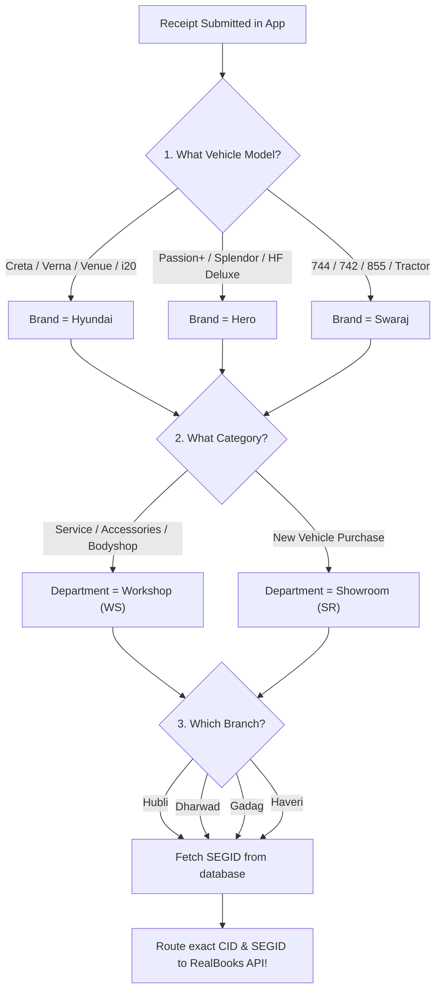
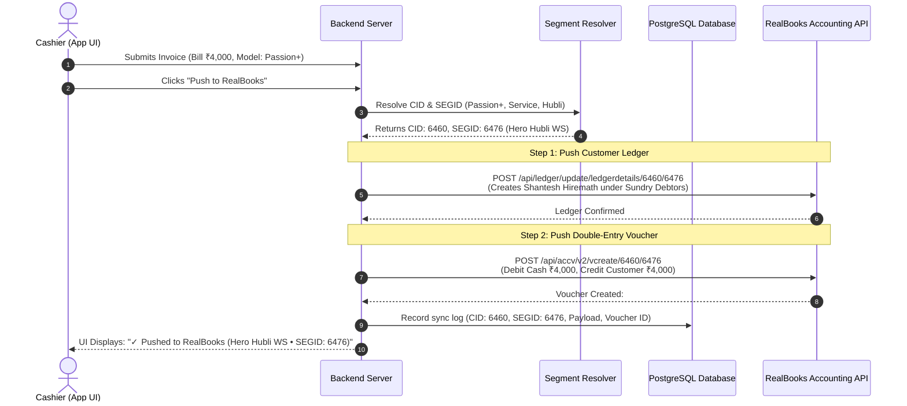

# RealBooks Integration Explained Simply: Complete Non-Technical Guide

This document explains in plain, everyday language how the **Bellad Loyalty App** connects to **RealBooks**, how ledgers and vouchers are created, and how the system automatically selects the correct **Segment ID (`segid`)** for every company, brand, and vehicle model.

---

## 1. What is an API and RealBooks in Everyday Words?

### The Restaurant Analogy:
Think of a restaurant:
- **You (The Customer at the Table)**: The Cashier or Director using the Bellad Loyalty App.
- **The Kitchen**: **RealBooks**, where all the accounting books, balance sheets, and tax reports are cooked and stored.
- **The Waiter**: The **API (Application Programming Interface)**.

```
┌────────────────────────┐         API (The Waiter)         ┌────────────────────────┐
│   Bellad Loyalty App   │ ───────────────────────────────> │  RealBooks Accounting  │
│  (Customer enters bill │ <─────────────────────────────── │  (Creates ledger &     │
│   & redeems points)    │       Returns Voucher ID         │   records transaction) │
└────────────────────────┘                                  └────────────────────────┘
```

You do not need to walk into the kitchen and write in the chef's book yourself. The **API waiter** takes the customer's name, bill amount, points redeemed, and vehicle model from our app, translates it into the exact format RealBooks demands, and brings back a confirmation: **"Voucher #10358066 Created Successfully"**.

---

## 2. What is a "Ledger" and Why Must We Create It First?

### What is a Customer Ledger?
In accounting, a **Ledger** is like a dedicated personal folder in a filing cabinet. 
- In RealBooks, every customer must have an account under the group **"Sundry Debtors"** (which means *"people who owe money or purchase services from the dealership"*).
- The folder is named: `Customer Name (Customer ID)`, for example:
  `SHANTESH SHIVALINGAIAH HIREMATH (BAC-8B27B02B)`

### Why do we push the Ledger before the bill?
RealBooks will **reject** any payment or receipt entry if the customer does not already have an account ledger.
Therefore, our integration operates in two automatic steps:
1. **Step 1**: It checks/creates the Customer's Ledger in RealBooks with their Phone, Address, and GSTIN.
2. **Step 2**: It posts the actual receipt money entry into that ledger.

---

## 3. What is a "Voucher" and Double-Entry Accounting?

A **Voucher** is the official receipt record in the accounting books.

RealBooks follows the global standard of **Double-Entry Bookkeeping**:
$$\text{Total Debit (Money Received/Discount Given)} = \text{Total Credit (Bill Cleared)}$$

### Real-World Example:
A customer brings their vehicle for service. The total bill is **₹4,000**.
- The customer redeems loyalty points for a **₹500 discount**.
- The customer pays the remaining **₹3,500 in cash**.

Here is how our app formats the voucher for RealBooks:

| Entry Type | Account Name | Account Group | Amount |
| :--- | :--- | :--- | :--- |
| **Debit (`dr`)** | Cash Account | Cash-in-hand | **₹3,500** |
| **Debit (`dr`)** | Loyalty Discount Allowed | Indirect Expenses | **₹500** |
| **Credit (`cr`)** | Customer Ledger | Sundry Debtors | **₹4,000** |

$$\text{Debit Total (₹3,500 + ₹500 = ₹4,000)} = \text{Credit Total (₹4,000)}$$

Both sides balance to the exact rupee, ensuring your chartered accountants and auditors have zero discrepancies.

---

## 4. What are `CID` and `SEGID`?

In RealBooks:
* **`CID` (Company ID)**: Identifies the registered company.
  - For Bellad and Company Demo, the `CID` is **`6460`**.
* **`SEGID` (Segment ID)**: Identifies the **specific branch and department** within that company.

### Why do we need different `SEGID`s?
Bellad & Company is not just one counter. You have:
1. **Different Brands / Models**: Hero bikes, Hyundai cars, Swaraj tractors.
2. **Different Cities**: Hubli, Dharwad, Gadag, Haveri.
3. **Different Departments**:
   - **Showroom (`SR`)**: Where new vehicles are sold.
   - **Workshop (`WS`)**: Where vehicles are serviced, repaired, or fitted with accessories.

Because money from a Hyundai car service in Hubli cannot be mixed with a Hero bike sale in Dharwad, RealBooks assigns a separate **Segment ID (`segid`)** to each counter.

```
                              ┌──────────────────────────────────────────────┐
                              │      Bellad and Company (CID: 6460)          │
                              └──────────────────────┬───────────────────────┘
                                                     │
         ┌───────────────────────────────────────────┼───────────────────────────────────────────┐
         │                                           │                                           │
┌──────────────────┐                        ┌──────────────────┐                        ┌──────────────────┐
│  Hero Moto Corp  │                        │     Hyundai      │                        │ Swaraj Tractors  │
│  (Parent: 6461)  │                        │  (Parent: 6462)  │                        │  (Parent: 6463)  │
└────────┬─────────┘                        └────────┬─────────┘                        └────────┬─────────┘
         │                                           │                                           │
 ┌───────┴───────┐                           ┌───────┴───────┐                           ┌───────┴───────┐
 │               │                           │               │                           │               │
Showroom      Workshop                    Showroom        Workshop                    Showroom        Workshop
(SR: 6475)    (WS: 6476)                  (SR: 6481)      (WS: 6482)                  (SR: 6490)      (WS: 6491)
```

---

## 5. Master Segment ID Lookup Table

All 38 segments from your configuration are stored in our database:

| Brand | City | Department / Nature | SEGID | SNAME | RealBooks Segment Name |
| :--- | :--- | :--- | :--- | :--- | :--- |
| **Hero** | Hubli | Workshop / Service (`WS`) | **`6476`** | `HHWS_D` | Hero Hubli WS_Demo |
| **Hero** | Hubli | Showroom / Sales (`SR`) | **`6475`** | `HHSR_D` | Hero Hubli SR_Demo |
| **Hero** | Dharwad | Workshop / Service (`WS`) | **`6474`** | `HDWS_D` | Hero Dharwad WS_Demo |
| **Hero** | Dharwad | Showroom / Sales (`SR`) | **`6473`** | `HDSR_D` | Hero Dharwad SR_Demo |
| **Hyundai** | Hubli | Workshop / Service (`WS`) | **`6482`** | `HYWS_D` | Hyundai Hubli WS_Demo |
| **Hyundai** | Hubli | Showroom / Sales (`SR`) | **`6481`** | `HYSR_D` | Hyundai Hubli SR_Demo |
| **Hyundai** | Dharwad | Workshop / Service (`WS`) | **`6488`** | `DRWS_D` | Hyundai Dharwad WS_Demo |
| **Hyundai** | Dharwad | Showroom / Sales (`SR`) | **`6487`** | `DRSR_D` | Hyundai Dharwad SR_Demo |
| **Hyundai** | Gadag | Workshop / Service (`WS`) | **`6486`** | `HGWS_D` | Hyundai Gadag WS_Demo |
| **Hyundai** | Gadag | Showroom / Sales (`SR`) | **`6485`** | `HGSR_D` | Hyundai Gadag SR_Demo |
| **Hyundai** | Haveri | Workshop / Service (`WS`) | **`6484`** | `HVWS_D` | Hyundai Haveri WS_Demo |
| **Hyundai** | Haveri | Showroom / Sales (`SR`) | **`6483`** | `HVSR_D` | Hyundai Haveri SR_Demo |
| **Swaraj** | Hubli | Workshop / Service (`WS`) | **`6491`** | `SHWS_D` | Swaraj Hubli WS_Demo |
| **Swaraj** | Hubli | Showroom / Sales (`SR`) | **`6490`** | `SHSR_D` | Swaraj Hubli SR_Demo |
| **Claas** | Hubli | Branch (`CH_D`) | **`6494`** | `CH_D` | Claas Hubli_Demo |
| **Sony** | Hubli | Branch (`SH_D`) | **`6492`** | `SH_D` | Sony Hubli_Demo |
| **Used Cars** | Hubli | Branch (`UCH_D`) | **`6496`** | `UCH_D` | Used Cars Hubli_Demo |
| **Head Office**| Hubli | General Branch | **`6469`** | `HO_D` | Head Office_Demo |
| **Company Root**| Hubli | Main Entity | **`6460`** | `BAC_D` | Bellad and Company_Demo |

---

## 6. How the App Automatically Detects the Segment ID

Neither cashiers nor accountants need to look up these IDs manually. When a receipt is submitted, the **RealBooks Segment Resolver Engine** runs an automatic 4-step decision:



### Live Example from your system:
* **Customer**: `SHANTESH SHIVALINGAIAH HIREMATH`
* **Vehicle**: Hero Moto Corp `PASSION+`
* **Category**: `service`
* **Branch**: `Sahil Motors - Annigeri` (Hubli region)
1. System reads model **`PASSION+`** $\rightarrow$ detects **`Hero`**.
2. System reads category **`service`** $\rightarrow$ detects **`Workshop (WS)`**.
3. System matches **`Hero Hubli WS_Demo`** in database.
4. System sets **`CID: 6460`** and **`SEGID: 6476`** automatically!

---

## 7. Step-by-Step Flow When a Cashier Clicks "Push to RealBooks"



---

## 8. Safe Sandbox Test Mode vs Live Production Mode

In your `.env` configuration file, there is a setting called `REALBOOKS_MODE`:

| Setting | What It Does | When to Use |
| :--- | :--- | :--- |
| **`REALBOOKS_MODE=test`** | **Safe Practice Sandbox**: The app tests all arithmetic formulas, checks the model, resolves the `segid`, and creates realistic mock vouchers (`RB-TEST-10291`) in your local audit logs **without changing any live accounting data in RealBooks**. | **Recommended for daily testing and cashier training.** |
| **`REALBOOKS_MODE=live`** | **Real Production Accounting**: The app sends real HTTP requests over the internet directly into RealBooks's live databases using your API keys. | **Use when chartered accountants are ready to sync live audit books.** |

---

## 9. Summary for Directors & Management

1. **Zero Manual Errors**: Cashiers do not need to memorize segment numbers or accounting codes. The app identifies the model and routes the ledger automatically.
2. **Audit Ready**: Every single request and response is stored in PostgreSQL table `realbooks_sync_log` with the exact timestamp, payload, and RealBooks voucher number.
3. **Double-Entry Compliant**: Debit always equals Credit, preventing tax and accounting book mismatch.
4. **Instant Transparency**: The cashier sees the exact segment name right on screen immediately after pushing.

